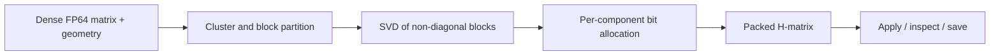

# qhmat

<p class="qh-kicker">Adaptive integer-quantized hierarchical matrices</p>

`qhmat` is for dense operators whose off-diagonal interactions can often be approximated economically, and for users who need to **measure the storage–accuracy trade-off explicitly**. It builds a geometric block partition, factors each non-diagonal block, assigns an integer bit width to each retained singular component, and retains diagonal blocks densely in FP64.

The output is a matrix object you can apply to vectors or multiple right-hand sides, inspect block by block, and save for later use. Construction starts from a dense array; it is not a matrix-free assembler or a drop-in fast BEM solver.

```python
import numpy as np
import qhmat

points = np.linspace(0, 1, 64)[:, None]
matrix = 1 / (np.abs(points - points.T) + 0.4)
h = qhmat.HMatrix.from_dense(matrix, points, tolerance=0.25, leaf_size=8)

print(h.storage_report())
print(np.max(np.abs(matrix - h.to_dense())), h.reconstruction_bound)
```

## Where it fits

| Good fit | Reconsider when |
| --- | --- |
| Kernel or discretized integral matrices with reusable geometric coordinates | The full matrix cannot be assembled in memory at all |
| Storage-focused studies with a max-norm representation budget | Every near-field block has high numerical rank and metadata dominates |
| Repeated use of a stored approximation with an inspectable partition | You need a demonstrated GPU speedup or a bound on every downstream solve |

!!! important "What the bound says"
    `h.reconstruction_bound` concerns the **stored matrix representation in exact arithmetic**. It does not include the error of constructing the dense source matrix, continuum discretization error, or all floating-point effects of `h @ x`.

## The workflow



The strict policy is deliberate: **all non-diagonal blocks**, including geometrically inadmissible near-field blocks, are stored as quantized factors. If a block cannot satisfy the budget at the available widths and rank limit, construction raises `InfeasibleError`; it does not silently switch that block to dense storage. A factorized near-field block can still be full rank or larger than a dense representation.

<div class="grid cards" markdown>

-   **Start with a working matrix**

    [Install and build](installation.md) · [Quickstart](quickstart.md)

-   **Understand the model**

    [Partition, bit allocation, and error](concepts.md) · [Storage measurements](storage.md)

-   **Follow a scientific example**

    [Point kernels](kernel.md) · [Boundary elements](bem.md) · [Integral operators](integral.md)

-   **Integrate the API**

    [Python and native reference](api.md) · [Contribute](contributing.md)

</div>
